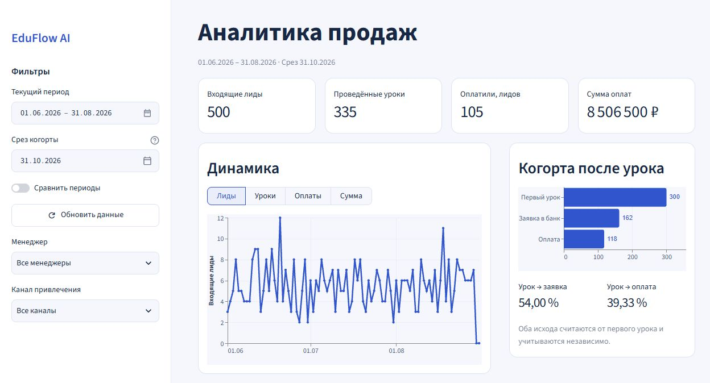

# EduFlow AI

Аналитика продаж онлайн-школы на Python. Руководитель может открыть дашборд, узнать, какой канал принёс больше денег, посмотреть причины отказов и получить утренний отчёт в Telegram. Проект показывает весь путь от выгрузки CRM в CSV или Excel до цифры в сообщении.

Этапы 1–5 и сквозная проверка TASK-6.1 завершены. Сейчас в работе TASK-6.2 — оформление портфолио. [Статусы задач](docs/ROADMAP.md)

**Демо на 500 синтетических лидах.** За июнь–август 2026 года 105 клиентов оплатили 8 506 500 ₽. Больше всего принёс органический поиск — 2 867 000 ₽. Из 300 клиентов с первым проведённым уроком в этом периоде 118 оплатили к 31 октября. Это когортная конверсия 39,33 %. [Сценарий показа за 8 минут](docs/DEMO_SCENARIO.md) · [Технический кейс](docs/PORTFOLIO_CASE_STUDY.md)



## Как это работает

| Задача | Что реализовано |
|---|---|
| Собрать продажи из выгрузок | Импорт проверяет пять связанных таблиц. Внешние ID позволяют распознать повторную загрузку и показать конфликты по строкам. |
| Сверить цифры | PostgreSQL считает 12 KPI. FastAPI, Streamlit и ежедневный отчёт используют общий расчёт. В дашборде есть фильтры по менеджеру и каналу, динамика и сравнение периодов. |
| Разобрать отказы и задать вопрос | Qwen выбирает одну из девяти причин отказа или план анализа. Python проверяет ID и цитаты, берёт суммы из отчёта, рассчитывает максимум и обрабатывает отсутствующие значения. |
| Доставить отчёт | n8n ежедневно в 09:00 (`Europe/Moscow`) запрашивает KPI за предыдущий день и отправляет их в Telegram. При повторе того же отчёта журнал доставки возвращает `already_sent`. |

**В проекте используются** Python 3.12, FastAPI, Pydantic, PostgreSQL 16, SQLAlchemy, Alembic, Streamlit, GroqCloud (Qwen), n8n, Telegram Bot API и Docker Compose. [Архитектура и потоки данных](docs/ARCHITECTURE.md) · [Определения KPI](docs/KPI_DEFINITIONS.md) · [Скриншоты аналитики, AI и n8n](docs/DEMO_SCENARIO.md)

## Локальный запуск

Для чистой копии нужны Docker с Compose и uv. В PowerShell из корня проекта выполните первую команду и задайте в созданном `.env` свой `POSTGRES_PASSWORD`. Если файл уже есть, используйте текущие настройки. Для дашборда достаточно PostgreSQL.

```powershell
if (-not (Test-Path .env)) { Copy-Item .env.example .env }
```

```powershell
uv sync --locked
docker compose up -d --wait postgres
uv run --locked alembic upgrade head
uv run --locked python -m scripts.generate_synthetic_data
uv run --locked python -m scripts.import_sales_data data/synthetic/generated --source-system synthetic_42
uv run --locked python -m uvicorn app.main:app --host 127.0.0.1 --port 8000
```

Во втором терминале запустите интерфейс и откройте [дашборд](http://127.0.0.1:8501). Контракт запросов доступен в [локальном Swagger UI](http://127.0.0.1:8000/docs).

```powershell
uv run --locked python -m streamlit run dashboard/main.py --server.address 127.0.0.1 --server.headless true
```

## Проверить результат

API и CLI возвращают итоги за один период. В третьем терминале можно сверить сумму по органическому поиску и проверить готовность локальной установки.

```powershell
$url = 'http://127.0.0.1:8000/api/v1/metrics?start_date=2026-06-01&end_date=2026-08-31&cutoff_date=2026-10-31&source=organic_search'
(Invoke-RestMethod $url).total.paid_amount_rub
uv run --locked python -m scripts.sales_report --start-date 2026-06-01 --end-date 2026-08-31 --cutoff-date 2026-10-31 --source organic_search
uv run --locked python -m scripts.smoke_stage6 --expect-leads 500 --skip-n8n
```

Прошли **259 тестов Python с PostgreSQL**, 16 тестов доставки на Node.js, два интеграционных сценария n8n и сверка 12 KPI между SQL и HTTP. В реальных прогонах Qwen правильно классифицировала 18 из 18 базовых и 24 из 24 сложных синтетических примеров. Получатель подтвердил и ручную, и автоматическую доставку отчёта в Telegram. [Отчёт Stage 6](docs/STAGE_6_TEST_REPORT.md) · [Замеры Qwen](docs/STAGE_4_TEST_REPORT.md#stage-4-acceptance) · [Проверка Telegram](docs/STAGE_5_TEST_REPORT.md)

## Границы MVP

Демо работает на локальной установке с синтетическими данными. Подключение реальной CRM потребует правил обновления записей, прав доступа и подготовки персональных данных. Качество классификации на реальных комментариях предстоит измерить отдельно.

[Развёртывание и диагностика](docs/DEPLOYMENT.md) · [Форматы CSV и Excel](docs/DATA_IMPORT.md) · [REST API](docs/API.md) · [AI-команды](docs/AI_ANALYSIS.md) · [Настройка Telegram](docs/STAGE_5_TELEGRAM.md) · [Дорожная карта](docs/ROADMAP.md)
