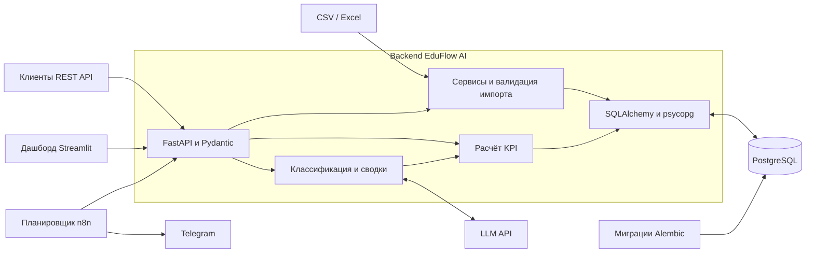

# Архитектура EduFlow AI

Диаграмма показывает целевое взаимодействие модулей первой версии. Uvicorn запускает приложение из `app/main.py`. FastAPI принимает файлы через `POST /api/v1/import` и отдаёт отчёты через `GET /api/v1/metrics`. [Контракт HTTP-маршрутов](API.md)

## Ответственность модулей

| Путь | Ответственность |
|---|---|
| `app/main.py` | Создание приложения FastAPI и подключение маршрутов. |
| `app/api/routes/`, `app/schemas/` | HTTP-обработчики и схемы запросов и ответов. |
| `app/core/` | Настройки из окружения и общая конфигурация приложения. |
| `app/database/` | Подключение, сессии и SQLAlchemy-модели. |
| `app/services/` | Сценарии работы с данными, проверка бизнес-правил, импорт и обработка дубликатов. |
| `app/analytics/`, `sql/queries/` | Параметризованный расчёт событийных и когортных KPI, срезов и дневной динамики. |
| `app/ai/` | Подготовка входа для LLM, вызов провайдера, проверка структуры ответа и обработка ошибок. |
| `dashboard/`, `workflows/` | Дашборд и расписание отчётности. Оба получают данные через API. |
| `migrations/` | Конфигурация, сценарии и версии миграций Alembic. |
| `tests/`, `scripts/`, `data/synthetic/` | Проверки, вспомогательные команды и синтетические данные. |

## Потоки данных

1. Генератор создаёт связанные CSV. CLI и API передают CSV и Excel общему сервису импорта. HTTP-обработчик сохраняет загруженные файлы во временную папку на время запроса. Сервис проверяет заголовки и поля, определяет родительские записи по внешним ID и сохраняет допустимые строки в PostgreSQL. JSON-отчёт содержит счётчики и причины отказа с номерами строк.
2. Слой аналитики принимает даты, срез и фильтры и возвращает итог и разбивки одним SQL-запросом. API и `scripts/sales_report.py` используют один расчёт и формат отчёта. Streamlit получает текущий и сравнительный отчёты по HTTP, строит графики Altair и показывает таблицы. Справочники менеджеров и каналов загружаются по отдельному маршруту из всей базы. Модели отчёта общие для FastAPI и Streamlit. [Контракт API](API.md), [графики Altair в Streamlit](https://docs.streamlit.io/develop/api-reference/charts/st.altair_chart)
3. Клиент LLM отправляет текст и схему ответа в OpenAI Responses API. Сервис отказов проверяет комментарии на признаки персональных данных до отправки, затем проверяет дословные цитаты и подсчитывает категории. Для сводок и вопросов модель выбирает ссылки на агрегаты, а сервис берёт значения из SQL-отчёта и вычисляет сравнения. Команды доступны через CLI. [Контракт клиента](LLM.md), [сценарии AI-аналитики](AI_ANALYSIS.md)
4. Сценарий n8n запускается по расписанию, вызывает API для сбора отчёта и отправляет результат через Telegram Bot API. Ошибки выполнения регистрируются для диагностики.

Генератор в `scripts/generate_synthetic_data.py` формирует пять связанных CSV. Он использует отдельный генератор случайных чисел с заданным `seed` и рассчитывает стабильные UUID из внешних идентификаторов. Сервис импорта определяет идентичность строки по паре `source_system` и `external_id`. PostgreSQL назначает UUID новым строкам. Родительские строки импортируются раньше дочерних. Уникальное ограничение защищает от дубликатов, а точка сохранения позволяет отклонить одну строку и продолжить обработку.

SQL в `sql/queries/sales_report.sql` объединяет строки событий через `UNION ALL` и агрегирует их по итогам, дням, менеджерам и источникам. Когорта формируется по первому проведённому уроку и проверяет наличие подходящей заявки или оплаты на каждого лида. При сравнении периодов API и CLI используют один снимок PostgreSQL в транзакции только для чтения.

## Подключение к локальной базе

- Docker Compose запускает PostgreSQL 16, публикует его порт на `127.0.0.1` и хранит каталог данных в именованном томе. `pg_isready` проверяет, что сервер принимает соединения.
- `PostgresSettings` в `app/core/config.py` читает и проверяет параметры из окружения и локального файла `.env`. Пароль хранится как `SecretStr` и раскрывается при передаче драйверу.
- `create_db_engine` в `app/database/connection.py` собирает параметры подключения через SQLAlchemy `URL.create`. Движок использует psycopg 3 и проверяет соединения из пула перед использованием. FastAPI создаёт этот пул при запуске приложения, а соединение открывается при первом обращении к базе.
- `python -m scripts.check_db` выполняет запрос через настоящее подключение. `GET /health` служит проверкой процесса API. Материалы для запуска и диагностики собраны в [README](../README.md).
- Структуру пяти таблиц, связи и ограничения для первой миграции задаёт [модель данных](DATA_MODEL.md).
- Модели SQLAlchemy используют общую `Base.metadata`. Alembic сравнивает метаданные с PostgreSQL и применяет версионированные миграции. При запуске API схема управляется отдельно через команды из [README](../README.md#миграции-базы-данных). [Сравнение схем в Alembic](https://alembic.sqlalchemy.org/en/latest/autogenerate.html)

## Границы и развитие

- Границы монолита проходят по ответственности Python-модулей. Это позволяет поддерживать одну точку расчёта KPI и одну схему миграций.
- HTTP-слой передаёт проверенные входные данные и формирует ответы. Правила обработки и расчётов находятся в сервисах и аналитике.
- Alembic применяет изменения схемы. Модели SQLAlchemy описывают отображение таблиц для приложения. Миграции и модели проверяются на согласованность.
- Сервис менеджеров принимает SQLAlchemy `Session`. Создание вызывает `flush()`, чтобы получить UUID от PostgreSQL. Границы транзакции задаёт вызывающий код, поэтому несколько операций можно фиксировать или откатывать вместе. Чтение использует первичный ключ. [Сессии SQLAlchemy](https://docs.sqlalchemy.org/en/21/orm/session_basics.html)
- Модульные тесты проверяют изолируемую логику. Интеграционные сценарии запускаются с `--integration` и применяют Alembic к временной тестовой базе PostgreSQL. Тесты AI-модуля по умолчанию используют контролируемые ответы провайдера.
- После MVP можно добавить кэширование, отчётность в других BI-системах, RAG и интеграции по отдельной потребности. Условия и порядок работ приведены в [дорожной карте](ROADMAP.md).
