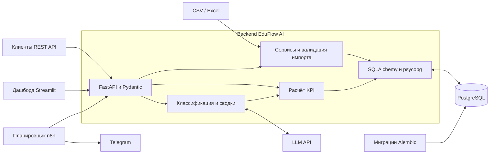

# Архитектура EduFlow AI

Диаграмма показывает целевое взаимодействие модулей первой версии. Первый рабочий HTTP-маршрут — `GET /health`. Uvicorn запускает приложение из `app/main.py`, FastAPI передаёт запрос обработчику в `app/api/routes/health.py`. Ответ `200 OK` подтверждает доступность приложения.

## Ответственность модулей

| Путь | Ответственность |
|---|---|
| `app/main.py` | Создание приложения FastAPI и подключение маршрутов. |
| `app/api/routes/`, `app/schemas/` | HTTP-обработчики и схемы запросов и ответов. |
| `app/core/` | Настройки из окружения и общая конфигурация приложения. |
| `app/database/` | Подключение, сессии и SQLAlchemy-модели. |
| `app/services/` | Сценарии работы с данными, проверка бизнес-правил, импорт и обработка дубликатов. |
| `app/analytics/`, `sql/queries/` | Расчёт KPI, согласованные фильтры и аналитические SQL-запросы. |
| `app/ai/` | Подготовка входа для LLM, вызов провайдера, проверка структуры ответа и обработка ошибок. |
| `dashboard/`, `workflows/` | Дашборд и расписание отчётности. Оба получают данные через API. |
| `migrations/` | Конфигурация, сценарии и версии миграций Alembic. |
| `tests/`, `scripts/`, `data/synthetic/` | Проверки, вспомогательные команды и синтетические данные. |

## Потоки данных

1. Генератор или импорт передаёт записи в сервис обработки. Сервис проверяет структуру и бизнес-правила, определяет дубликаты и передаёт проверенные записи в PostgreSQL. Результат импорта сообщает, какие строки обработаны и где возникли ошибки.
2. Пользователь задаёт фильтры в Streamlit. API валидирует параметры, вызывает слой аналитики и возвращает агрегаты для графиков и таблиц. Слой аналитики определяет единый способ расчёта для всех потребителей.
3. AI-модуль получает обезличенные комментарии и готовые агрегаты. Метрики вычисляются в SQL/Python, а LLM классифицирует текст и составляет выводы. Ответ модели валидируется по схеме. Для ошибок провайдера, таймаутов и лимитов предусмотрена обработка.
4. Сценарий n8n запускается по расписанию, вызывает API для сбора отчёта и отправляет результат через Telegram Bot API. Ошибки выполнения регистрируются для диагностики.

## Подключение к локальной базе

- Docker Compose запускает PostgreSQL 16, публикует его порт на `127.0.0.1` и хранит каталог данных в именованном томе. `pg_isready` проверяет, что сервер принимает соединения.
- `PostgresSettings` в `app/core/config.py` читает и проверяет параметры из окружения и локального файла `.env`. Пароль хранится как `SecretStr` и раскрывается при передаче драйверу.
- `create_db_engine` в `app/database/connection.py` собирает параметры подключения через SQLAlchemy `URL.create`. Движок использует psycopg 3 и проверяет соединения из пула перед использованием.
- `python -m scripts.check_db` выполняет запрос через настоящее подключение. `GET /health` служит проверкой процесса API. Материалы для запуска и диагностики собраны в [README](../README.md).

## Границы и развитие

- Границы монолита проходят по ответственности Python-модулей. Это позволяет поддерживать одну точку расчёта KPI и одну схему миграций.
- HTTP-слой передаёт проверенные входные данные и формирует ответы. Правила обработки и расчётов находятся в сервисах и аналитике.
- Alembic применяет изменения схемы. Модели SQLAlchemy описывают отображение таблиц для приложения. Миграции и модели проверяются на согласованность.
- Модульные тесты проверяют изолируемую логику. Интеграционные сценарии работают с отдельной тестовой базой PostgreSQL. Тесты AI-модуля по умолчанию используют контролируемые ответы провайдера.
- После MVP можно добавить кэширование, отчётность в других BI-системах, RAG и интеграции по отдельной потребности. Условия и порядок работ приведены в [дорожной карте](ROADMAP.md).
