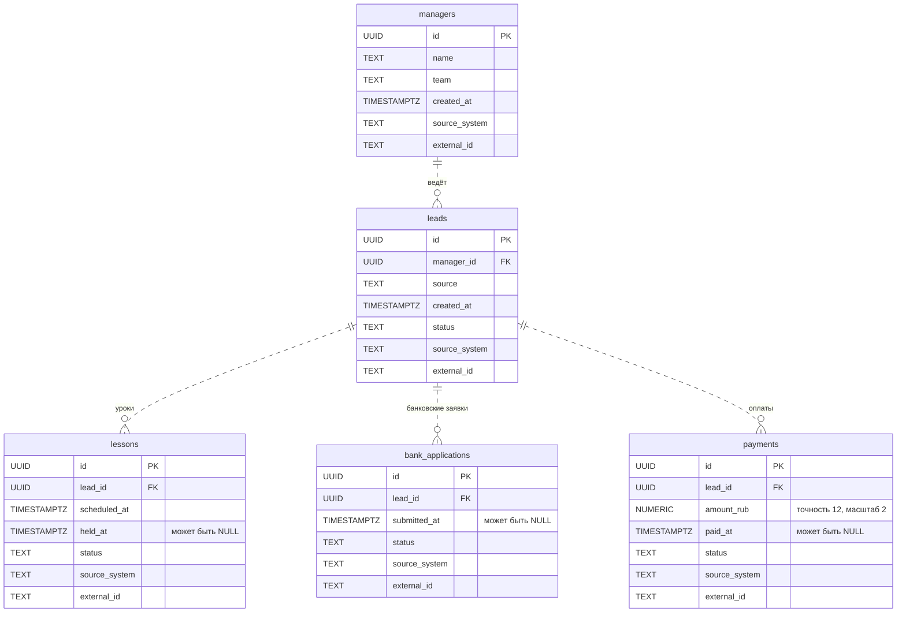

# Модель данных

Спецификация схемы PostgreSQL 16. Ревизия `0001` создаёт таблицы, ревизия `0002` добавляет внешние идентификаторы импорта. Обе ревизии сопоставлены с [моделями SQLAlchemy](../app/database/models/sales.py). [Первая миграция](../migrations/versions/0001_initial_schema.py) · [Миграция идентификаторов импорта](../migrations/versions/0002_import_identity.py)

## ER-диаграмма

У лида ровно один менеджер. У менеджера может быть от нуля до многих лидов. У каждого урока, банковской заявки и платежа ровно один лид. У лида может быть от нуля до многих записей каждого из этих типов. Первичный ключ каждой строки состоит из её собственного `id`.

## Общие правила

- Все `id` имеют тип `UUID`, являются первичными ключами и по умолчанию создаются в PostgreSQL функцией `gen_random_uuid()`. Импорт и генератор могут передать заранее известный UUID. [Функции UUID в PostgreSQL 16](https://www.postgresql.org/docs/16/functions-uuid.html)
- Все внешние ключи обязательны. Для них действуют `ON DELETE RESTRICT` и `ON UPDATE RESTRICT`, чтобы ссылки на менеджеров и лидов сохранялись. PostgreSQL индексирует первичные ключи автоматически. Индексы на стороне внешних ключей определены ниже. [Ограничения в PostgreSQL 16](https://www.postgresql.org/docs/16/ddl-constraints.html)
- `TIMESTAMPTZ` хранит момент в UTC. Приложение принимает даты со смещением или явным часовым поясом и формирует отчётные дни по `Europe/Moscow`. Календарный фильтр переводится в UTC до запроса. В таблицах допустимы только конечные даты. [Типы даты и времени в PostgreSQL 16](https://www.postgresql.org/docs/16/datatype-datetime.html)
- Статусы хранятся в `TEXT NOT NULL`, допустимые значения закреплены именованными `CHECK`. `NULL` для даты означает, что соответствующее событие ещё не произошло или было отменено до наступления.
- Для первой версии используются синтетические данные. Имена, телефоны и другие персональные данные учеников в схеме отсутствуют.

## Таблицы

«—» в столбце по умолчанию означает отсутствие серверного значения по умолчанию.

### `managers` — менеджеры

| Поле | Тип | NULL | По умолчанию | Назначение |
|---|---|---|---|---|
| `id` | `UUID` | Нет | `gen_random_uuid()` | Первичный ключ. |
| `name` | `TEXT` | Нет | — | Имя менеджера. |
| `team` | `TEXT` | Нет | — | Название команды. |
| `created_at` | `TIMESTAMPTZ` | Нет | `CURRENT_TIMESTAMP` | Момент создания записи. |

### `leads` — входящие заявки

| Поле | Тип | NULL | По умолчанию | Назначение |
|---|---|---|---|---|
| `id` | `UUID` | Нет | `gen_random_uuid()` | Первичный ключ. |
| `manager_id` | `UUID` | Нет | — | Внешний ключ на `managers.id`. |
| `source` | `TEXT` | Нет | — | Код источника для фильтрации и группировки. |
| `created_at` | `TIMESTAMPTZ` | Нет | — | Момент поступления лида из источника. |
| `status` | `TEXT` | Нет | `'new'` | `new` — новый, `in_progress` — в работе, `won` — закрыт с продажей, `lost` — закрыт без продажи. |

`status` отражает состояние работы с лидом. Метрики продаж опираются на записи из `payments`. Имена менеджеров, коды источников, даты и суммы могут повторяться. Ключи для повторной загрузки описаны в разделе об импорте.

### `lessons` — вводные уроки

| Поле | Тип | NULL | По умолчанию | Назначение |
|---|---|---|---|---|
| `id` | `UUID` | Нет | `gen_random_uuid()` | Первичный ключ. |
| `lead_id` | `UUID` | Нет | — | Внешний ключ на `leads.id`. |
| `scheduled_at` | `TIMESTAMPTZ` | Нет | — | Текущий слот в расписании. При переносе обновляется у той же записи. |
| `held_at` | `TIMESTAMPTZ` | Да | — | Момент фактического начала урока. Обязателен для `completed`. |
| `status` | `TEXT` | Нет | — | `scheduled` — назначен, `completed` — проведён, `cancelled` — отменён, `no_show` — неявка. |

Урок может фактически начаться раньше назначенного времени. Каждый повторный урок хранится отдельной строкой.

### `bank_applications` — банковские заявки

| Поле | Тип | NULL | По умолчанию | Назначение |
|---|---|---|---|---|
| `id` | `UUID` | Нет | `gen_random_uuid()` | Первичный ключ. |
| `lead_id` | `UUID` | Нет | — | Внешний ключ на `leads.id`. |
| `submitted_at` | `TIMESTAMPTZ` | Да | — | Момент отправки. При отмене после отправки сохраняется. |
| `status` | `TEXT` | Нет | — | `submitted` — отправлена, `approved` — одобрена, `declined` — отклонена, `cancelled` — отменена. |

При отмене до отправки `submitted_at` остаётся `NULL`.

### `payments` — оплаты

| Поле | Тип | NULL | По умолчанию | Назначение |
|---|---|---|---|---|
| `id` | `UUID` | Нет | `gen_random_uuid()` | Первичный ключ. |
| `lead_id` | `UUID` | Нет | — | Внешний ключ на `leads.id`. |
| `amount_rub` | `NUMERIC(12, 2)` | Нет | — | Положительная сумма в рублях с точностью до копеек. |
| `paid_at` | `TIMESTAMPTZ` | Да | — | Момент оплаты. При возврате сохраняется время исходной оплаты. |
| `status` | `TEXT` | Нет | — | `pending` — ожидается, `paid` — оплачен, `refunded` — возвращён. |

Суммы обрабатываются через `Decimal`. Импорт проверяет сумму до записи и отклоняет значения, которые потребовали бы округления до копеек. `refunded` хранит факт возврата. Дата, частичные возвраты и бухгалтерская чистая выручка требуют отдельной финансовой модели. [Числовые типы PostgreSQL 16](https://www.postgresql.org/docs/16/datatype-numeric.html)

## Ключи и проверки для миграции

Первичные ключи именуются `pk_<таблица>`. Внешние ключи и ограничения `CHECK` используют следующие имена и условия.

| Внешний ключ | Ссылка |
|---|---|
| `fk_leads_manager_id_managers` | `leads.manager_id` → `managers.id` |
| `fk_lessons_lead_id_leads` | `lessons.lead_id` → `leads.id` |
| `fk_bank_applications_lead_id_leads` | `bank_applications.lead_id` → `leads.id` |
| `fk_payments_lead_id_leads` | `payments.lead_id` → `leads.id` |

| Таблица | Имя `CHECK` | Условие |
|---|---|---|
| `managers` | `ck_managers_name_nonblank` | `name ~ '[^[:space:]]'` |
| `managers` | `ck_managers_team_nonblank` | `team ~ '[^[:space:]]'` |
| `managers` | `ck_managers_created_at_finite` | `isfinite(created_at)` |
| `leads` | `ck_leads_source_nonblank` | `source ~ '[^[:space:]]'` |
| `leads` | `ck_leads_created_at_finite` | `isfinite(created_at)` |
| `leads` | `ck_leads_status` | `status IN ('new', 'in_progress', 'won', 'lost')` |
| `lessons` | `ck_lessons_status` | `status IN ('scheduled', 'completed', 'cancelled', 'no_show')` |
| `lessons` | `ck_lessons_dates_finite` | `isfinite(scheduled_at) AND (held_at IS NULL OR isfinite(held_at))` |
| `lessons` | `ck_lessons_held_at_status` | `(status = 'completed') = (held_at IS NOT NULL)` |
| `bank_applications` | `ck_bank_applications_status` | `status IN ('submitted', 'approved', 'declined', 'cancelled')` |
| `bank_applications` | `ck_bank_applications_submitted_at_finite` | `submitted_at IS NULL OR isfinite(submitted_at)` |
| `bank_applications` | `ck_bank_applications_submitted_at_status` | `status = 'cancelled' OR submitted_at IS NOT NULL` |
| `payments` | `ck_payments_status` | `status IN ('pending', 'paid', 'refunded')` |
| `payments` | `ck_payments_amount_rub_positive` | `amount_rub > 0 AND amount_rub <> 'NaN'::numeric` |
| `payments` | `ck_payments_paid_at_finite` | `paid_at IS NULL OR isfinite(paid_at)` |
| `payments` | `ck_payments_paid_at_status` | `(status IN ('paid', 'refunded')) = (paid_at IS NOT NULL)` |

Проверки SQL ограничивают одну строку. Согласованность дат со временем поступления связанного лида проверяет будущий сервис импорта. Порядок «урок → заявка или оплата» проверяется в когортном запросе. Так заявка или оплата до урока может попадать в отчёт по событиям за свой период. [Проверки `CHECK` в PostgreSQL 16](https://www.postgresql.org/docs/16/ddl-constraints.html#DDL-CONSTRAINTS-CHECK-CONSTRAINTS)

## Идентификаторы для повторного импорта

Ревизия `0002` добавляет поля `source_system TEXT` и `external_id TEXT` ко всем пяти таблицам. `source_system` — постоянный код экземпляра CRM или независимого набора данных из настроек импорта. Поле `leads.source` описывает канал привлечения. `external_id` — стабильный идентификатор строки во внешней системе. Оба поля обязательны для импортированной записи. Для внутренних записей допустимы два `NULL`. В каждой таблице `ck_<таблица>_external_identity` проверяет совместную заполненность и формат значений. `uq_<таблица>_external_identity` закрепляет уникальность пары. [Уникальные ограничения PostgreSQL](https://www.postgresql.org/docs/16/ddl-constraints.html#DDL-CONSTRAINTS-UNIQUE-CONSTRAINTS)

- Код системы закрепляют за источником до первого импорта. Код использует 1–64 строчные латинские буквы, цифры и подчёркивания. Для одного экземпляра CRM его переиспользуют в последовательных выгрузках и разных форматах. Переименование файла или смена номера строки сохраняет идентичность заявки.
- `external_id` читается как текст с удалением пробельных символов по краям. Регистр и ведущие нули сохраняются. После очистки допустимо 1–255 символов. В Excel ячейка ID должна быть текстовой. Для файлов без ID постоянные идентификаторы один раз добавляют в источник. Пустой ID считается ошибкой строки.
- При вставке PostgreSQL разрешает конфликт по уникальной паре через `ON CONFLICT DO NOTHING`. Для совпавшего ключа импорт использует существующий UUID. Совпавшие данные отмечаются как повтор, изменившиеся поля — как конфликт для проверки. В обоих случаях существующая запись сохраняется. [INSERT и ON CONFLICT в PostgreSQL](https://www.postgresql.org/docs/16/sql-insert.html)
- Ссылки на менеджера и лида определяются по их внешней паре в том же источнике. У каждого урока, банковской заявки и платежа свой внешний ID. Это сохраняет отдельно повторные уроки или платежи с разными внешними ID. Даты этих событий должны быть не раньше даты создания связанного лида.

Например, две загрузки заявки `00042` из `demo_crm` дают одну строку и один UUID. Заявка `00042` из `another_crm` получает свой UUID. Приёмка импорта включает повторную загрузку, конкурирующие вставки одного ключа, отсутствующий ID и конфликт изменённых полей. Объединение записей из разных источников и связывание нескольких внешних ID с одним лидом потребуют отдельной таблицы соответствий. Решение закреплено в [ADR-011](DECISIONS.md#adr-011--идентификаторы-для-повторного-импорта).

### Формат синтетических файлов

- Генератор записывает один CSV на таблицу. В файлах присутствуют поля схемы и внешние идентификаторы для импорта.
- `source_system` имеет вид `synthetic_<seed>`. `external_id` стабилен в пределах таблицы и источника. Внутренний UUID вычисляется из кода источника, имени таблицы и внешнего ID.
- `manager_external_id` в лидах и `lead_external_id` в событиях ссылаются на внешние ID родительской записи в том же источнике. Они согласованы с UUID в `manager_id` и `lead_id`.
- Заголовки всегда присутствуют. Разделитель — запятая. Кодировка — UTF-8. Время записано в ISO 8601 с `+00:00`, деньги в рублях с двумя дробными знаками. Пустое значение даты соответствует `NULL`.

## Индексы

Первоначальный набор состоит из обычных неуникальных B-tree-индексов. Левый столбец составного индекса обращений к событиям — внешний ключ. Самостоятельные индексы по датам нужны для отчётов по периоду без фильтра по конкретному лиду. Фактическую пользу индексов проверяем на запросах этапа 2. [Многоколоночные индексы в PostgreSQL 16](https://www.postgresql.org/docs/16/indexes-multicolumn.html)

| Таблица | Индекс | Столбцы в порядке индекса | Основной запрос |
|---|---|---|---|
| `leads` | `ix_leads_created_at` | `(created_at)` | Входящие лиды за период. |
| `leads` | `ix_leads_manager_id_created_at` | `(manager_id, created_at)` | Лиды менеджера и проверка ссылок на менеджера. |
| `leads` | `ix_leads_source_created_at` | `(source, created_at)` | Отчёт по выбранному источнику за период. |
| `lessons` | `ix_lessons_lead_id_held_at` | `(lead_id, held_at)` | Уроки лида, поиск первого проведённого урока. |
| `lessons` | `ix_lessons_scheduled_at` | `(scheduled_at)` | Уроки по запланированной дате. |
| `lessons` | `ix_lessons_held_at` | `(held_at)` | Проведённые уроки за период. |
| `bank_applications` | `ix_bank_applications_lead_id_submitted_at` | `(lead_id, submitted_at)` | Поиск заявки лида после первого урока. |
| `bank_applications` | `ix_bank_applications_submitted_at` | `(submitted_at)` | Поданные заявки за период. |
| `payments` | `ix_payments_lead_id_paid_at` | `(lead_id, paid_at)` | Поиск оплаты лида после первого урока. |
| `payments` | `ix_payments_paid_at` | `(paid_at)` | Оплаты и сумма оплат за период. |

## Сверка с KPI

| Отчёт | Данные схемы |
|---|---|
| Входящие лиды и срезы | `leads.created_at`, `leads.manager_id`, `leads.source`. Уроки, заявки и оплаты получают менеджера и источник через свой лид. |
| Назначенные и проведённые уроки | `scheduled_at` для календаря, `held_at` и `status = 'completed'` для проведённых занятий. Единица учёта — строка урока. |
| Клиенты с банковской заявкой | `bank_applications.lead_id`, `submitted_at` и статусы `submitted`, `approved`, `declined`. |
| Оплатившие клиенты, сумма и средний чек | `payments.lead_id`, `amount_rub`, `paid_at` и статус `paid`. Каждый платёж участвует в сумме, каждый платящий лид — один раз в знаменателе. |
| Конверсии урок → заявка и урок → оплата | Сначала первый `held_at` по лиду среди проведённых уроков. Затем проверка наличия подходящего события после урока до среза. Единица учёта — уникальный лид. |
| Динамика и сравнение периодов | Моменты событий в `TIMESTAMPTZ`, границы по `Europe/Moscow`, дата среза для когорт. |

Формулы, границы периодов и пример приведены в [определениях KPI](KPI_DEFINITIONS.md). Для восстановления прошлых состояний понадобятся история переназначений, переносов уроков и переходов статусов.

## Сценарии приёмки первой миграции

| Сценарий | Ожидаемое поведение |
|---|---|
| Лид с неизвестным менеджером или событие с неизвестным лидом | Отклоняется внешним ключом. |
| Удаление менеджера с лидами или лида с событиями | Отклоняется внешним ключом. |
| Два урока, две банковские заявки и две оплаты одного лида | Принимаются с разными UUID. |
| `completed` без `held_at` или `no_show` с `held_at` | Отклоняется. Проведённый урок с фактическим началом раньше слота принимается. |
| `cancelled` с датой подачи или без неё | Принимается в обоих случаях. `approved` без даты подачи отклоняется. |
| `pending` с датой оплаты или `refunded` без даты оплаты | Отклоняется. `refunded` с датой первоначальной оплаты принимается. |
| Нулевая, отрицательная или `NaN` сумма | Отклоняется. Суммы от 0,01 ₽ допустимы в пределах точности столбца. |
| Пустой источник, пробельное имя, неизвестный статус или бесконечная дата | Отклоняется соответствующим ограничением. |
