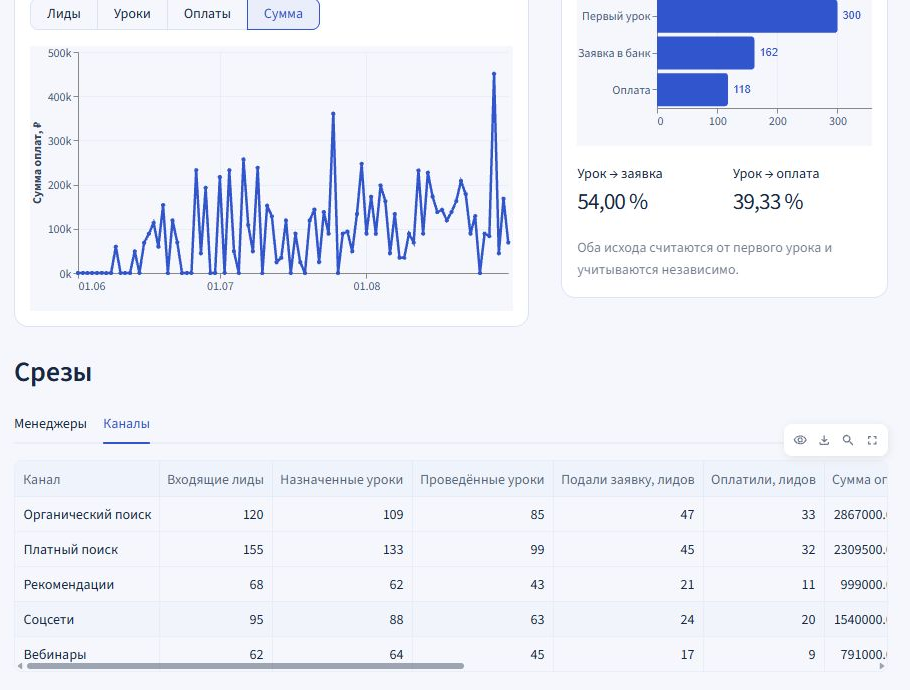
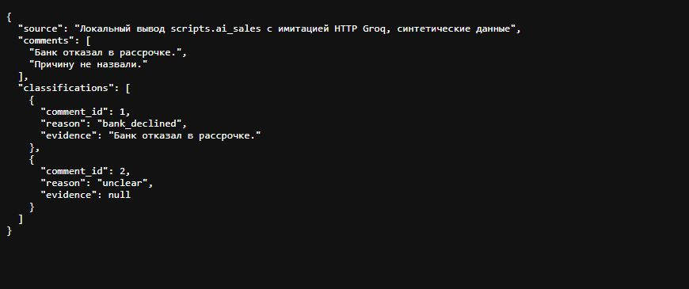
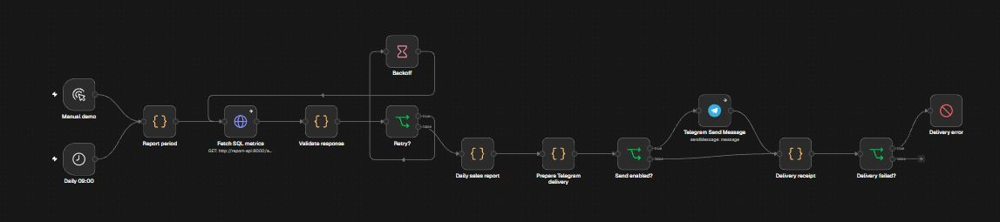

# Демонстрация EduFlow AI за 8 минут

Покажем, откуда взялась сумма 8 506 500 ₽, какой канал дал больше всего оплат по сумме и как тот же отчёт попал руководителю в Telegram. Все суммы относятся к синтетической школе. Основной показ работает без ключа Groq и без новой отправки в Telegram.

## Подготовить до встречи

В чистой копии выполните разделы 1–2 руководства по развёртыванию. Нужны PowerShell, uv, Docker, пустая демонстрационная база и стандартный набор с `seed=42`. Оставьте FastAPI и Streamlit запущенными в отдельных терминалах. Для живого просмотра журнала нужен локальный вход в n8n с ранее сохранённым выполнением. В новой копии можно использовать экспорт с выключенной доставкой и материалы ниже. [Команды развёртывания](DEPLOYMENT.md)

Проверьте стенд из третьего терминала. Ожидаются семь строк `PASS` и `SKIP` для Groq. Смешанные наборы от разных импортов изменят эталонные суммы.

```powershell
uv run --locked python -m scripts.smoke_stage6 --expect-leads 500
```

## A. От выгрузки до базы · 0:00–1:30

На подготовленной базе повторите те же команды. Они также подходят для первой загрузки после настройки окружения. Генератор воспроизводит пять файлов, а импорт пишет отдельный итог по каждой таблице.

```powershell
docker compose up -d --wait postgres
uv run --locked alembic upgrade head
uv run --locked python -m scripts.generate_synthetic_data
uv run --locked python -m scripts.import_sales_data data/synthetic/generated --source-system synthetic_42
```

При первой загрузке будет 500 лидов, 8 менеджеров, 481 урок, 209 банковских заявок и 196 записей об оплатах. При повторной — 1 394 совпадающие строки суммарно. Число записей об оплатах включает частичные платежи и разные статусы. Сколько клиентов действительно оплатили в выбранном периоде, покажет запрос в части B. [Правила импорта](DATA_IMPORT.md)

## B. От SQL к фильтру в дашборде · 1:30–3:30

Откройте [Streamlit](http://127.0.0.1:8501) и проверьте период 01.06–31.08.2026, срез 31.10.2026, все каналы и менеджеры. Получите тот же период из FastAPI.

```powershell
$url = 'http://127.0.0.1:8000/api/v1/metrics?start_date=2026-06-01&end_date=2026-08-31&cutoff_date=2026-10-31'
$report = Invoke-RestMethod $url
$report.total | Select-Object leads, completed_lessons, paying_leads, paid_amount_rub, lesson_to_payment_pct
(Invoke-RestMethod ($url + '&source=organic_search')).total.paid_amount_rub
```

1. Сверьте карточки с HTTP-ответом. Должны совпасть 500 лидов, 335 проведённых уроков, 105 оплативших и 8 506 500 ₽.
2. В блоке «Динамика» выберите «Сумма». Ниже откройте «Срезы» → «Каналы». В боковой панели выберите «Канал привлечения» → «Органический поиск». Карточка суммы покажет 2 867 000 ₽, как во втором запросе.
3. Верните «Все каналы». На графике когорты 300 лидов, у которых первый проведённый урок попал в период. Из них 118 оплатили до среза включительно, отсюда 39,33 %. Календарный счётчик 105 отвечает на другой вопрос — сколько клиентов оплатили именно летом. [Определения и знаменатели](KPI_DEFINITIONS.md)



## C. От комментария до проверяемого ответа · 3:30–5:45

Запустите три коротких сценария приложения с имитацией HTTP Groq. Затем откройте сохранённый фрагмент вывода CLI. Он получен на двух синтетических комментариях и стандартном SQL-отчёте. Внешних запросов в этих командах нет.

```powershell
uv run --locked python -m pytest -q tests/unit/test_ai_sales.py -k 'classification_preserves_input_order or summary_values_and_hypothesis or ranked_answer_calculates'
$demo = Get-Content -Raw -Encoding utf8 docs/assets/demo_ai_output.json | ConvertFrom-Json
$demo.classifications | Format-Table comment_id, reason, evidence
$demo.summarize
$demo.ask
```

- Покажите `bank_declined` и точную цитату «Банк отказал в рассрочке.». У комментария с неизвестной причиной результат `unclear`, а `evidence` в JSON равен `null`.
- Прочитайте сводку с суммой 8 506 500 ₽ и конверсией 39,33 %. На вопрос «Какой источник принёс больше всего денег?» ответ указывает на `organic_search` и 2 867 000 ₽. Сверьте с фильтром из части B. В имитации заданы категория и план, значения сводки и ответа подставляет приложение.
- Для обсуждения качества модели откройте протокол реальных запусков Qwen на 18 базовых и 24 сложных примерах. [Реальные замеры](STAGE_4_TEST_REPORT.md#stage-4-acceptance) · [Сохранённый вывод демо](assets/demo_ai_output.json)



<details>
<summary>Вариант с реальным Groq, если есть ключ и квота</summary>

Задайте `GROQ_API_KEY` в локальном `.env`. Команды ниже расходуют квоту и могут занять дольше отведённого времени. Используйте только синтетические данные этого демо.

```powershell
New-Item -ItemType Directory -Force data/local | Out-Null
'["Банк отказал в рассрочке.","Причину не назвали."]' | Set-Content -Encoding utf8 data/local/demo_comments.json
uv run --locked python -m scripts.ai_sales classify data/local/demo_comments.json
uv run --locked python -m scripts.sales_report --start-date 2026-06-01 --end-date 2026-08-31 --cutoff-date 2026-10-31 | Set-Content -Encoding utf8 data/local/demo_report.json
uv run --locked python -m scripts.ai_sales summarize data/local/demo_report.json
uv run --locked python -m scripts.ai_sales ask data/local/demo_report.json 'Какой источник принёс больше всего денег?'
```

</details>

## D. От SQL до сообщения · 5:45–8:00

1. В [локальном n8n](http://127.0.0.1:5678) откройте **EduFlow — Daily Sales Report → Executions**. Выберите сохранённое успешное ручное выполнение за демонстрационный период. Для показа достаточно открыть его историю.
2. В **Fetch SQL metrics** покажите полученные KPI. В **Daily sales report** и **Prepare Telegram delivery** найдите текст с периодом, суммой, числом оплативших, средним чеком и конверсией. Расписание формирует такой же отчёт за предыдущий день.
3. В **Delivery receipt** проверьте `sent`, одну попытку и положительный `message_id`. В рабочем ручном запуске № 8 получатель подтвердил сообщение в чате. Сверьте 105 оплативших и средний чек 81 014,29 ₽. Повтор распознаётся как `already_sent`, а неопределённый исход помечается `unknown`. [Протокол ручной доставки](STAGE_5_TEST_REPORT.md#task-52--доставка-отчёта-в-telegram)
4. На новом стенде без этой истории покажите схему и сохранённый протокол. В экспортированном workflow ручная и плановая отправка выключены. [Настройка владельцем](STAGE_5_TELEGRAM.md)


